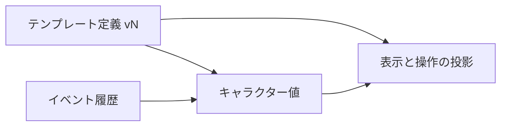

# TRPG キャラクターシートのデータ保持パターン

> **分類**：調査、設計リファレンス
> **対象**：キャラクターシート基盤、テンプレート設計、API と DB のデータ設計
> **ステータス**：初版
> **最終更新**：2026-09-27

対応する UI 表示案は [キャラクターシートのデータパターン UI ワイヤーフレーム](character-sheet-data-pattern-wireframes.md) にまとめている。

## 1. この資料の対象

TRPG のキャラクターシートには、名前や能力値のような単純な値だけでなく、計算値、残量、使用回数、装備行、人物関係、秘匿情報、成長履歴が混在する。

この資料は、それらをゲーム固有の項目名から切り離し、再利用できる**データ保持パターン**として整理する。

対象は「何をどう保存するか」であり、紙面の見た目や特定ゲームのルール解説ではない。

個別ルールの数値や裁定は各ルールブックを正本とする。

## 2. 先に押さえる設計原則

キャラクターシート全体を一つの JSON として保存できても、すべてを同じ種類の値として扱えるわけではない。

データ設計では、少なくとも次の違いを保つ必要がある。

- プレイヤーが入力した値と、式から求めた値
- 現在値と、上限や初期値
- 順序がある行と、順序に意味がない集合
- 同じ種類の箱と、それぞれ役割が異なる固定枠
- 現在の状態と、そこへ至った操作履歴
- 表示されない値と、権限がなく読み取れない値
- キャラクター自身の値と、別のキャラクターや共有シートへの参照

これらを区別しないモデルは、初期に扱う少数のシステムには適合しても、対象ゲームを増やした時点で自由記述欄や例外フラグへ情報が集中する。

## 3. 三層に分けて持つ

同じ「シート」に見える情報でも、変更理由と寿命が異なる。

テンプレート、キャラクター値、イベント履歴を分けると、公開済みテンプレートの改版、同時編集、ロールバック、監査を扱いやすい。

| 層 | 保持するもの | 代表例 | 更新の契機 |
|---|---|---|---|
| **テンプレート定義** | 項目の型、式、選択肢、並び、表示条件、権限 | HP の上限式、技能の一覧、装備行の列定義 | テンプレート編集と改版 |
| **キャラクター値** | キャラクターごとの入力値と現在状態 | STR、現在 HP、所持品の各行、取得済みタグ | 作成、編集、セッション中の操作 |
| **イベント履歴** | 値を変えた事実と、その文脈 | ダメージ適用、回数消費、公開、成長、ロール結果 | コマンドやユーザー操作 |



キャラクターは作成時に使ったテンプレートの ID と版を保持する。

公開後のテンプレートを直接書き換えると、既存キャラクターの式やフィールド参照が同じデータのまま別の意味になるため、公開版は不変にして改版するほうが安全である。

## 4. パターン一覧

以下の 19 パターンを組み合わせると、多くのキャラクターシートを記述できる。

| ID | パターン | 代表的な用途 | 中心となるデータ |
|---|---|---|---|
| D01 | 単一入力値 | 名前、年齢、能力値、設定文 | 型付きの単一値 |
| D02 | 選択とフラグ | 種族、クラス、習熟、取得済み | 選択肢 ID または真偽値 |
| D03 | 内訳を持つ数値 | 基礎値、成長、装備補正、一時補正 | 名前付き加算要素 |
| D04 | 導出値 | 能力修正、最大 HP、技能合計 | 式と参照先 |
| D05 | 参照表と条件分岐 | ダメージボーナス、ランク別効果 | 表、条件、入力値 |
| D06 | ダイス記法とロール操作 | 判定、攻撃、作成時ロール | 記法、参照、用途 |
| D07 | 上下するリソース | HP、MP、正気度、侵蝕率 | 現在値、下限、上限、閾値 |
| D08 | 同種のチェック箱 | ストレス、死亡判定の成功数 | 箱数または各箱の状態 |
| D09 | リセットされる使用回数 | スペルスロット、特技回数、神業 | 残数、上限、リセット契機 |
| D10 | 状態とタグの集合 | 変調、コンディション、アスペクト | 状態 ID の集合と付加情報 |
| D11 | 複合行の反復リスト | 武器、呪文、装備、特技 | 安定した行 ID と列値 |
| D12 | 意味の異なる固定枠 | 軽度、中度、重度の負傷枠 | 固定枠 ID と内容 |
| D13 | 意味を持つ二次元配置 | 特技表、部位表、位置関係 | 座標、セル状態、距離規則 |
| D14 | 対象との関係 | 絆、ロイス、感情、因縁 | 対象参照と関係属性 |
| D15 | 選択に応じた構成 | クラス、プレイブック、シンドローム | 選択と有効になる項目群 |
| D16 | 秘匿と公開遷移 | 秘密、奥義、非公開メモ | 閲覧範囲と公開状態 |
| D17 | 成長と変更履歴 | 経験点、能力上昇、負傷履歴 | 追記型イベントと現在スナップショット |
| D18 | 下位シートと共有シート | 従者、車両、国、ギルド | 別実体への参照 |
| D19 | 配分プールと制約 | 技能ポイント、作成点、重量 | 予算、消費先、残量式 |

## 5. 基本値と計算のパターン

### D01 単一入力値

最小単位は、数値、文字列、真偽値のいずれか一つを持つフィールドである。

識別子、表示名、値型を分け、表示名を保存値のキーにしない。

表示名は翻訳や表記変更で変わるが、識別子は式や履歴から参照され続けるためである。

```json
{
  "fieldId": "strength",
  "label": "STR",
  "valueType": "number",
  "value": 55
}
```

長い経歴文や外見の説明も文字列値に含まれる。

ただし、複数人物との関係や複数の負傷を一つの文章へ詰め込むと検索、更新、権限制御ができないため、反復する情報は D11 または D14 に分ける。

### D02 選択とフラグ

候補が決まっている値は自由記述ではなく、選択肢 ID を保存する。

表示ラベルを変更しても保存済みデータの意味を維持できるよう、`"fighter"` のような安定 ID と「戦士」のようなラベルを分ける。

複数選択は配列、オンかオフだけで十分な項目は真偽値を使う。

選択によってシート構造が変わる場合は、値の保存だけでなく D15 も必要になる。

### D03 内訳を持つ数値

最終値だけでなく、基礎値、成長分、装備補正、一時補正を別々に編集したい数値がある。

この場合は名前付きの内訳を保存し、合計を導出する。

```json
{
  "base": 3,
  "growth": 2,
  "equipment": 1,
  "temporary": -1
}
```

この例の表示値は `3 + 2 + 1 - 1 = 5` である。

最終値の `5` だけを正本にすると、装備を外したときにどの `1` を戻すべきか判断できない。

一方、内訳を利用者が個別に編集する必要がない能力値まで分解すると入力負荷が増えるため、D03 は補正の発生源を保つ必要がある項目へ限定する。

### D04 導出値

別の値から決まる項目は、利用者の入力値ではなく式として定義する。

保存する中心は式と参照先であり、計算結果は表示用のキャッシュまたは投影として扱う。

```json
{
  "fieldId": "maxHp",
  "resultType": "number",
  "formula": "floor(({abilities.con} + {abilities.siz}) / 10)"
}
```

計算結果も保存する場合は、元の値や式が変わったときに再計算する契約と、どちらを正本とするかを明記する。

式には循環参照、未解決参照、型の不一致、評価コストの上限を検査する必要がある。

### D05 参照表と条件分岐

算術式だけで決まらない値は、ルール上の表をデータとして持つ。

入力範囲から結果を引く表、離散キーから値を引く表、複数条件による分岐が代表例である。

```json
{
  "tableId": "damageBonus",
  "rows": [
    { "min": 2, "max": 64, "result": "-2" },
    { "min": 65, "max": 84, "result": "-1" },
    { "min": 85, "max": 124, "result": "0" },
    { "min": 125, "max": 164, "result": "+1d4" }
  ]
}
```

表の結果は数値とは限らず、文字列、真偽値、ダイス式になる場合がある。

ルール表をアプリケーションコードの条件分岐へ埋め込むと、テンプレート改版とコードのリリースが結び付くため、表として検証可能な形に保つ。

### D06 ダイス記法とロール操作

ダイス記法は「保存された能力値」ではなく、その値を使う操作の定義である。

判定ボタンなら記法、参照するフィールド、表示名、公開範囲をテンプレートに持たせる。

ロール結果はキャラクターの恒久値へ上書きせず、原則としてイベント履歴へ記録する。

ただし、能力値決定のような作成時ロールは、出目を D01、D03、D07 の初期値へ反映する操作として扱う。

## 6. 残量と状態のパターン

### D07 上下するリソース

HP のような値は、現在値と上限を別に持つ。

上限は固定値にも D04 の式にもなり、下限、閾値、上限超過の可否はゲームごとに異なる。

```json
{
  "current": 8,
  "min": 0,
  "max": { "formula": "{abilities.maxHp}" },
  "thresholds": [
    { "at": 4, "label": "重傷域" }
  ]
}
```

「範囲外を拒否する」「境界へ丸める」「警告だけ出して保存する」のいずれかを、入力経路ごとではなく項目の方針として統一する。

### D08 同種のチェック箱

同じ意味の箱が並び、チェック数だけが意味を持つ場合は、現在数と箱数で表現できる。

個々の箱を任意の順で消したり、箱ごとに別の値を持たせたりする場合は、各箱に ID と状態を持たせる。

[Fate Core の公式シート](https://evilhat.com/wp-content/uploads/2022/04/Fate-Core-Character-Sheet.pdf)では、肉体と精神のストレスが番号付きの箱として表現されている。

これは現在値と最大値だけのゲージに見えるが、ルールが箱の個別性を参照するなら配列として保存する必要がある。

### D09 リセットされる使用回数

使用回数は D07 と似ているが、「いつ、何へ戻るか」がデータの一部である。

```json
{
  "remaining": 2,
  "max": 3,
  "resetOn": "rest",
  "resetTo": "max"
}
```

シーン終了、セッション終了、休息、日次などのリセット契機に加えて、誰がリセットを発火できるかを決める。

レベル別スペルスロットのように複数のまとまりがある場合は、D09 を D11 の行として繰り返す。

### D10 状態とタグの集合

取得順に意味がなく、重複を許さない状態は集合として持つ。

単なる `string[]` で足りるのは、状態名だけで完結するときである。

強度、付与者、期限、公開範囲を伴う状態は、次のようなオブジェクトの集合にする。

```json
{
  "statusId": "poisoned",
  "level": 2,
  "source": "trap-17",
  "expiresOn": "sceneEnd"
}
```

アスペクトのような自由入力タグと、システムが定義した状態 ID は、入力制約と意味が異なるため区別する。

## 7. 集合と関係のパターン

### D11 複合行の反復リスト

武器、呪文、装備、特技は、複数の列を持つ行が任意数並ぶ。

```json
{
  "rowId": "weapon_k7m2",
  "name": "リボルバー",
  "skillRef": "skills.handgun",
  "damage": "1d10",
  "ammo": 6,
  "notes": ""
}
```

配列の位置は並べ替えで変わるため、行の参照や更新には安定した `rowId` を使う。

行の中からシート全体の能力値を参照する式と、シート全体からリストを集計する式は、参照方向を分けて定義する。

無制限のリスト内リストは編集 UI、式参照、差分解決を複雑にするため、深い入れ子は D18 の別実体へ分ける。

### D12 意味の異なる固定枠

枠が空でも存在し、枠ごとに容量や効果が異なる場合は、可変長リストではなく固定枠として持つ。

[Fate Core のコンセクエンス欄](https://evilhat.com/wp-content/uploads/2022/04/Fate-Core-Character-Sheet.pdf)にある軽度、中度、重度の枠が代表例である。

```json
[
  { "slotId": "mild", "capacity": 2, "value": null },
  { "slotId": "moderate", "capacity": 4, "value": "腕の骨折" },
  { "slotId": "severe", "capacity": 6, "value": null }
]
```

D08 は同種の箱の個数を扱い、D12 は各枠の固有の意味を扱う。

### D13 意味を持つ二次元配置

行と列の位置、セル間の距離、空きマスがルールへ影響する表は、表示用グリッドではない。

座標とセル ID を保存し、距離計算や隣接規則をテンプレート側に持たせる。

通常のフィールドを CSS Grid で並べただけでは、配置を変更したときにルール上の意味まで変わってしまう。

### D14 対象との関係

絆、ロイス、感情、因縁は、「相手」と「相手に対する属性」の組である。

```json
{
  "relationId": "rel_82f1",
  "target": { "kind": "character", "characterId": "char_123" },
  "attributes": {
    "positive": "信頼",
    "negative": "嫉妬",
    "state": "active"
  }
}
```

相手がシステム内に存在しない NPC なら自由記述も許せるが、参照と自由記述を同じ文字列へ押し込まない。

参照先の名前が変わった場合、表示名は追従しても、関係そのものの同一性は `characterId` で維持する。

### D15 選択に応じた構成

クラス、プレイブック、種族などの選択によって、入力項目や取得候補が変わるシートがある。

これは D02 の値だけでは表せない。

選択されたカタログ要素と、その要素が追加するフィールド群をテンプレート部品として分ける。

表示条件だけで隠した項目にも値が残る可能性があるため、「非表示」「無効」「値を削除」のどれを意味するかを定める。

### D16 秘匿と公開遷移

秘匿は表示設定ではなく、読み取り権限と状態遷移である。

```json
{
  "visibleTo": ["owner", "gm"],
  "state": "hidden",
  "revealedAt": null,
  "revealedBy": null
}
```

CSS で隠すだけでは API 応答やログから読めるため、サーバーが閲覧者ごとに値を除外する。

公開後も再び隠せるか、公開が誰に伝播するか、公開時刻を履歴へ残すかもデータ契約に含まれる。

### D17 成長と変更履歴

現在の経験点だけでは、獲得と消費の根拠を追えない。

現在値のスナップショットに加えて、追記型の履歴を持つ。

```json
{
  "eventId": "evt_301",
  "kind": "advancement",
  "delta": -10,
  "reason": "技能を成長",
  "fieldRef": "skills.libraryUse",
  "occurredAt": "2026-09-27T12:00:00Z"
}
```

毎回イベントを全件再生して画面を作る必要はない。

現在値を高速な読み取り用に保存し、履歴を説明、監査、取り消しに使う構成が扱いやすい。

### D18 下位シートと共有シート

従者、車両、拠点、国、ギルドは、名前だけの付属品ではなく独自の能力値や装備を持つことがある。

親キャラクターの JSON へ無制限に入れ子にせず、別のシート実体として保存して参照する。

共有シートでは複数所有者、編集権限、同時更新が必要になるため、通常のキャラクター所有権を流用しない。

### D19 配分プールと制約

技能ポイントや作成点では、複数フィールドの合計が予算内に収まること自体がルールである。

予算、集計対象、集計する内訳をテンプレートに持ち、残量を導出する。

```json
{
  "poolId": "occupationPoints",
  "total": 240,
  "targets": ["skills.accounting", "skills.libraryUse"],
  "partsKey": "occupation",
  "remainingFormula": "total - sum(targets.occupation)"
}
```

各フィールドの上限と、複数フィールド全体の合計予算は別の制約である。

## 8. 代表的なシステムをパターンへ写像する

この表は各ゲームを完全に再現するものではなく、公式シートで確認できる代表的な構造をパターンへ対応づけたものである。

| システム | 公式シートに見られる構造 | 対応するパターン |
|---|---|---|
| [Call of Cthulhu 7th Edition](https://www.chaosium.com/cthulhu-character-sheets/) | 能力値、技能値、半分値と 5 分の 1 値、HP と正気度、武器行、バックストーリー | D01、D04、D05、D07、D11 |
| [Dungeons & Dragons 2024](https://media.dndbeyond.com/compendium-images/phb/downloads/DnD_2024_Character-Sheet.pdf) | 能力値と修正値、HP、ヒットダイス、死亡セーヴ、武器行、クラス特徴 | D01、D02、D04、D07、D08、D09、D11 |
| [Pathfinder Second Edition Remaster](https://downloads.paizo.com/RemasterPlayerCoreCharacterSheet.pdf) | 基礎値と習熟やアイテム補正、現在 HP と一時 HP、状態、武器行、クラス特技 | D03、D04、D07、D10、D11 |
| [Fate Core](https://evilhat.com/wp-content/uploads/2022/04/Fate-Core-Character-Sheet.pdf) | アスペクト、技能段階、肉体と精神のストレス、固有容量を持つコンセクエンス枠 | D10、D08、D12 |
| [Cyberpunk RED](https://rtalsoriangames.com/wp-content/uploads/2020/11/RTG-CPR-CharacterSheet.pdf) | 能力値と技能、武器と装備、サイバーウェア、ライフパス、友人、敵、出来事 | D01、D03、D11、D14、D17 |

公式シートだけでは、セッション中のリセット、公開権限、履歴の保存方法まで確定しない。

その部分はルール本文とアプリケーションの操作要件を別途確認する必要がある。

## 9. 実装時の判断規則

### 入力値と導出値を分ける

利用者が変更できる値だけをキャラクター値の正本にする。

式で再現できる値を入力欄として重複保存すると、参照元だけを更新したときに値が食い違う。

### ID と表示名を分ける

テンプレート、セクション、フィールド、反復行、固定枠には安定 ID を与える。

式、差分、履歴、Discord の操作 ID は表示名や配列位置ではなく安定 ID を参照する。

### 値の型と操作を分ける

数値であることと、ダイスを振れることは別の性質である。

同じ数値フィールドにロール操作、増減操作、プロフィール表示を注釈として付けると、保存形式を UI ごとに増やさずに済む。

### リセットと公開をイベントとして扱う

「休息したら全回復する」「秘密を公開する」は単なる値更新ではない。

発火者、対象範囲、適用前後の値を履歴へ残すと、誤操作の説明と取り消しが可能になる。

### レイアウトをルールから分ける

二列表示やカード表示はレイアウトであり、通常は値の意味を変えない。

D13 のように座標自体がルールへ影響するときだけ、配置を値モデルへ昇格させる。

### 制約違反の扱いを統一する

上限超過や予算超過を拒否するか、丸めるか、警告だけにするかを明記する。

Web では警告、Discord では丸めるというように入力経路ごとに変えると、同じキャラクター値に異なる規則が適用される。

## 10. 避けたい保持方法

| 保持方法 | 問題 | 置き換え先 |
|---|---|---|
| すべてを `Record<string, number>` に入れる | 文字列、関係、行、秘匿、履歴を表せない | 型付きフィールドの直和 |
| 装備や関係を説明文へ連結する | 個別更新、検索、ロール参照ができない | D11、D14 |
| 配列位置を行 ID にする | 並べ替えと削除で参照先が変わる | 安定した `rowId` |
| 導出結果だけを保存する | 元の値や式の変更に追従できない | D04、D05 |
| `isVisible` 一つで秘匿を表す | 誰に見えるか、公開済みかを区別できない | D16 |
| 現在値だけを保存して変更理由を捨てる | 成長、消費、取り消しを説明できない | D17 |
| レイアウト座標を全フィールドの意味に使う | 見た目の変更がルール変更になる | 通常レイアウトと D13 の分離 |
| テンプレート更新を既存キャラクターへ暗黙適用する | 式とフィールドの意味が途中で変わる | 版固定と明示移行 |

## 11. 最小の汎用モデル

すべてのパターンを一つの巨大なフィールド型へ詰め込む必要はない。

基本フィールド、複合構造、ドメイン実体を分けた最小形は次のようになる。

```ts
interface SheetTemplate {
  templateId: string
  version: string
  sections: SectionDefinition[]
  lookupTables: LookupTable[]
}

interface CharacterSheet {
  characterId: string
  templateRef: { templateId: string; version: string }
  values: Record<FieldUid, unknown>
  revision: number
}

type FieldDefinition =
  | ScalarField
  | ComputedField
  | RollField
  | TrackField
  | ListField
  | FixedSlotField
  | TagField
  | RelationField
  | GridField

interface SheetEvent {
  eventId: string
  characterId: string
  kind: string
  actorId: string
  occurredAt: string
  payload: unknown
}
```

`CharacterSheet.values` の `unknown` は無検証で保存してよいという意味ではない。

実際の書き込みでは、対応する `FieldDefinition` に基づいて値を検証する。

## 12. このリポジトリの schema v3 との対応

現行 schema v3 は、頻出パターンを `scalar`、`computed`、`roll`、`track`、`list`、`relation`、`tag` の直和で表現する。

`parts`、参照表、ブロック、配分プール、Discord 用 role 注釈も定義されている。

| 分類 | 現行の主な受け皿 | 補足 |
|---|---|---|
| 直接表現できる | D01 から D07、D11、D14、D19 | 複数の型や注釈を組み合わせる場合を含む |
| 規約または組み合わせが必要 | D08、D09、D10、D12 | 箱の個別性や固定枠の意味を失わないエンコードが必要 |
| 基盤外または将来拡張 | D13、D15 から D18 | 特技表、条件付き構成、閲覧者別秘匿、履歴、共有シートは別設計が必要 |

型が存在していても、エディタ、入力画面、publish 検証、Discord 投影のすべてが同じ成熟度とは限らない。

実装可否は [具体設計 v1](character-sheet-proposals/design-v1.md)、[フィールド型充足性監査](character-sheet-proposals/field-sufficiency-audit.md)、[エンコード集](character-sheet-proposals/encoding-cookbook.md) と実コードを合わせて確認する。

既存の P1 から P14 との大まかな対応は次のとおりである。

| 既存調査 | この資料 |
|---|---|
| P1 から P5 | D01 から D06 |
| P6 | D13 |
| P7 | D14 |
| P8、P11 | D07 から D09、D12 |
| P9 | D10 |
| P10 | D16 |
| P12 | D15 |
| P13 | D17 |
| P14 | D18 |
| 既存設計の blocks、pools | D03、D19 |

## 13. 参照資料

### リポジトリ内

- [TRPG システム横断調査](character-sheet-proposals/trpg-system-survey.md)：14 系統を P1 から P14 へ正規化した先行調査
- [具体設計 v1](character-sheet-proposals/design-v1.md)：schema v3 の型、式、参照、値の意味論
- [エンコード集](character-sheet-proposals/encoding-cookbook.md)：個別システムを schema v3 で表すレシピ
- [キャラクターシートテンプレート JSON 仕様](character-sheet-template-json-spec.md)：現在の入力 JSON 契約

### 公式シート

- [Call of Cthulhu Character Sheets](https://www.chaosium.com/cthulhu-character-sheets/)：Chaosium。能力値、技能、リソース、武器、バックストーリーの例
- [D&D 2024 Character Sheet](https://media.dndbeyond.com/compendium-images/phb/downloads/DnD_2024_Character-Sheet.pdf)：D&D Beyond。能力値と修正値、HP、死亡セーヴ、武器、特徴の例
- [Pathfinder Second Edition Remaster Character Sheet](https://downloads.paizo.com/RemasterPlayerCoreCharacterSheet.pdf)：Paizo。補正内訳、HP、状態、技能、攻撃行の例
- [Fate Core Character Sheet](https://evilhat.com/wp-content/uploads/2022/04/Fate-Core-Character-Sheet.pdf)：Evil Hat Productions。アスペクト、ストレス箱、コンセクエンス枠の例
- [Cyberpunk RED Character Sheet](https://rtalsoriangames.com/wp-content/uploads/2020/11/RTG-CPR-CharacterSheet.pdf)：R. Talsorian Games。装備、サイバーウェア、ライフパス、人物関係の例

これらの公式シートはパターンの実例を確認するために参照した。

「多くの TRPG に必ず同じ項目がある」ことを示す統計資料ではない。
